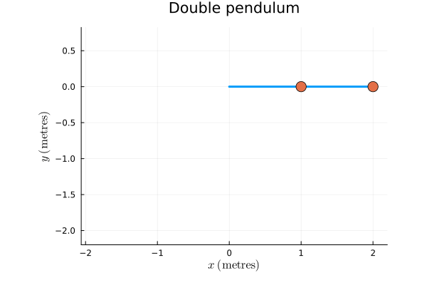

~~~
<figure id="dp" style="float: right;">

<figcaption>Double pendulum animation.</figcaption>
</figure>
~~~
In this article, I explain to Fidello from Foci's Discord server some prerequisite knowledge he needs to effectively derive the equations of motion for a double rigid pendulum and then cover more advanced topics for him. In theory, the derivation of the equations of motion for a double rigid pendulum can be done with Newtonian mechanics with $\textbf{F}=m\mathbf{a}$, but given our second pendulum is in a moving reference frame and Newtonian mechanics does not easily adapt to alternative coordinate systems, like polar coordinates, Lagrangian mechanics makes the equations of motion easier to derive. Lagrangian mechanics also leads nicely into Hamiltonian mechanics and the path integral formulation of quantum mechanics. Figure \figref{dp} shows an animation of the double rigid pendulum. [This page](/doublePendulum/) does interactive simulations of this system if you would like to specify the parameter values yourself. Below is the Julia code used to generate the above double pendulum animation. I will mention that the Julia code included in this article was largely generated with the help of ChatGPT. 

```julia:./code/doublepen
using DifferentialEquations
using Plots

# ------------------------------------------------------------
# Parameters
# ------------------------------------------------------------

g   = 9.81
l₁  = 1.0
l₂  = 1.0

m₁ᵣ = 1.0
m₁ᵦ = 1.0
m₂ᵣ = 1.0
m₂ᵦ = 1.0
fps = 30

# ------------------------------------------------------------
# Equations of motion
#
# u = [θ₁, θ₂, θ̇₁, θ̇₂]
# ------------------------------------------------------------

function double_pendulum!(du, u, p, t)

    θ₁, θ₂, θ̇₁, θ̇₂ = u

    Δ = θ₁ - θ₂

    # Common terms
    M₁ = m₁ᵣ/12 + m₁ᵦ + m₂ᵦ

    D₂ = (m₂ᵣ/12 + m₂ᵦ) * l₂ -
         (m₂ᵦ^2 * l₂^2 * cos(Δ)^2) / M₁

    F₁ = m₂ᵦ * l₂ * θ̇₂^2 * sin(Δ) +
         g * cos(θ₁) *
         (m₁ᵣ/2 + m₂ᵣ + m₁ᵦ + m₂ᵦ)

    F₂ = m₂ᵦ * (
             l₁ * θ̇₁^2 * sin(Δ) -
             g * cos(θ₂)
         )

    # Equations from the supplied expressions
    du[1] = θ̇₁
    du[2] = θ̇₂

    du[3] = -F₁ / (M₁ * l₁)

    du[4] = (
        (m₂ᵦ * cos(Δ) / M₁) * F₁ +
        F₂
    ) / D₂
end

# ------------------------------------------------------------
# Initial conditions
# ------------------------------------------------------------

θ₁₀  = 0.0
θ₂₀  = 0.0
θ̇₁₀ = 0.0
θ̇₂₀ = 0.0

u₀ = [θ₁₀, θ₂₀, θ̇₁₀, θ̇₂₀]

# ------------------------------------------------------------
# Solve
# ------------------------------------------------------------

tspan = (0.0, 60.0)

prob = ODEProblem(double_pendulum!, u₀, tspan)

sol = solve(
    prob,
    Tsit5(),
    saveat=1/fps,
    abstol=1e-9,
    reltol=1e-9
)

# ------------------------------------------------------------
# Coordinates of the two bobs
#
# The angles in the supplied equations are measured from the
# horizontal, hence:
#
# x₁ = l₁ cos(θ₁)
# y₁ = l₁ sin(θ₁)
#
# x₂ = x₁ + l₂ cos(θ₂)
# y₂ = y₁ + l₂ sin(θ₂)
# ------------------------------------------------------------

x₁ = l₁ .* cos.(sol[1, :])
y₁ = l₁ .* sin.(sol[1, :])

x₂ = x₁ .+ l₂ .* cos.(sol[2, :])
y₂ = y₁ .+ l₂ .* sin.(sol[2, :])

# ------------------------------------------------------------
# Animation
# ------------------------------------------------------------

xmin = minimum(x₂) - 0.2
xmax = maximum(x₂) + 0.2
ymin = minimum(y₂) - 0.2
ymax = maximum(y₂) + 0.2

anim = @animate for i in eachindex(sol.t)

    plot(
        [0, x₁[i], x₂[i]],
        [0, y₁[i], y₂[i]],
        linewidth=3,
        label=false,
        xlims=(xmin, xmax),
        ylims=(ymin, ymax),
        aspect_ratio=:equal,
        xlabel=L"x\ (\mathrm{m})",
        ylabel=L"y\ (\mathrm{m})",
        title="Double pendulum"
    )

    scatter!(
        [x₁[i], x₂[i]],
        [y₁[i], y₂[i]],
        markersize=8,
        label=false
    )
end

gif(anim, "Double_pendulum.gif", fps=fps)
```
