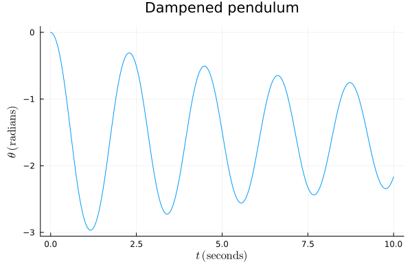
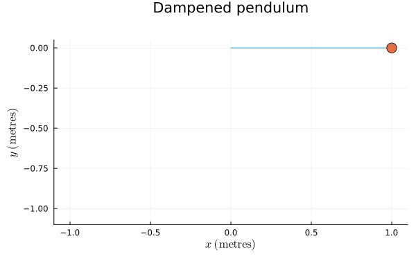

#### With air resistance
For the sake of simplicity, we will only consider the air resistance experienced by the pendulum bob itself, not by the rod. The air resistance force vector for the pendulum bob would be:
\begin{align*}
    \textbf{F}_D &= -\dfrac{\rho C_D A|v|\textbf{v}}{2}.
\end{align*}
Where $\textbf{v}$ is the velocity vector of the bob. It is equal to $(\dot{x}, \dot{y})$.
Hence:
\begin{align*}
    \textbf{F}_D &= -\dfrac{\rho C_D Al|\dot{\theta}|}{2}(\dot{x}, \dot{y}) \\
    &= -\dfrac{\rho C_D Al|\dot{\theta}|}{2} (-l\dot{\theta}\sin{\theta}, l\dot{\theta}\cos{\theta}) \\
    &= \dfrac{\rho C_D Al^2|\dot{\theta}|\dot{\theta}}{2} (\sin{\theta}, -\cos{\theta}).
\end{align*}
To find the generalized force term, we need to find $\dfrac{\partial \textbf{r}}{\partial \theta}$:
\begin{align*}
    \dfrac{\partial \textbf{r}}{\partial \theta} &= \left(\dfrac{\partial x}{\partial \theta}, \dfrac{\partial y}{\partial \theta}\right) \\
    &= (-l\sin{\theta}, l\cos{\theta}).
\end{align*}
Hence:
\begin{align}
    Q_{\theta} &= \textbf{F}_D \cdot \dfrac{\partial \textbf{r}}{\partial \theta} \nonumber \\
    &= \dfrac{\rho C_D Al^2|\dot{\theta}|\dot{\theta}}{2} (\sin{\theta}, -\cos{\theta}) \cdot (-l\sin{\theta}, l\cos{\theta}) \nonumber \\
    &= \dfrac{\rho C_D Al^2|\dot{\theta}|\dot{\theta}}{2}(-l\sin^2{\theta}-l\cos^2{\theta}) \nonumber \\
    &= -\dfrac{\rho C_D Al^3|\dot{\theta}|\dot{\theta}}{2}. \label{Qtheta}
\end{align}
Hence Equations \eqref{ELENCF} become:
\begin{align*}
    ml^2 \ddot{\theta} + mgl\cos{\theta} &= -\dfrac{\rho C_D Al^3|\dot{\theta}|\dot{\theta}}{2}.
\end{align*}
Dividing by $ml^2$ yields:
\begin{align*}
    \ddot{\theta} + \dfrac{g}{l}\cos{\theta} &= -\dfrac{\rho C_D Al|\dot{\theta}|\dot{\theta}}{2m}.
\end{align*}
Subtracting $\dfrac{g}{l}\cos{\theta}$ from both sides yields:
\begin{align*}
    \ddot{\theta} &= -\dfrac{g}{l}\cos{\theta} -\dfrac{\rho C_D Al|\dot{\theta}|\dot{\theta}}{2m}.
\end{align*}
This equation cannot be analytically solved, so numerical solutions are necessary. There is a numerical solver for an even more complex version of the dampened single pendulum [here](/singlePendulum/). Below is some Julia code for numerically solving the dampened single pendulum problem with $\theta_0=0$, $\dot{\theta}_0=0$, $g=9.81\mathrm{m}\cdot \mathrm{s}^{-2}$, $l=1\mathrm{m}$, $m=1\mathrm{kg}$, $\rho=2.0 \mathrm{kg}\cdot \mathrm{m}^{-3}$, $C_D=0.01$ (dimensionless) and $A=5.0\mathrm{m}^2$. 

\codelisting{damppen}{Single pendulum with air resistance simulation code.}
```julia:./code/damppen
\juliacode{fidello/code/damppen.jl}
```
Figure \figref{damppen} shows the plot produced by Code Listing \coderef{damppen}. As you can see over time the maximum and minimum angle the pendulum forms gets closer and closer towards $-\dfrac{\pi}{2}$. Figure \figref{damppenan} shows the animation produced by the above Julia code. 
~~~
<figure id="damppen" style="float: left;">

<figcaption>Dampened pendulum angle plot.</figcaption>
</figure>
<figure id="damppenan" style="float: right;">

<figcaption>Dampened pendulum animation.</figcaption>
</figure>
~~~
