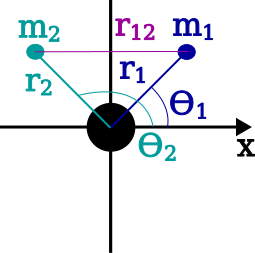
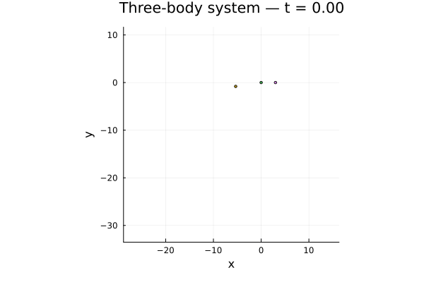

### Gravitational three-body problem
~~~
<figure id="threebody" style="float: right;">

<figcaption>Gravitational three-body problem.</figcaption>
</figure>
~~~
I thought a good example for you would be the gravitational three-body problem. As like the double pendulum problem, it exhibits chaos. Further, it is the premise of a popular scifi Netflix series *3 Body Problem*, which is based on a novel called *Remembrance of Earth's Past*. As you can see in Figure \figref{threebody}, our axes are selected such that the mass $M$ is centred at the origin. Consequently, the central mass does not move on our axes. So only the two other masses contribute to our system's kinetic energy:
\begin{align*}
T &= \dfrac{m_1}{2}(\dot{r}_1^2 + r_1^2 \dot{\theta}_1^2) + \dfrac{m_2}{2}(\dot{r}_2^2+r_2^2\dot{\theta}_2^2).
\end{align*}
I omitted the calculation of the velocity of the two moving bodies as they are identical to the velocity calculation for the [two-body problem](#example_gravitational_two-body_problem).

To calculate the potential energy, we will need to calculate $r_{12}$, the distance between the masses $m_1$ and $m_2$. To calculate this, we will start with the $x$ and $y$ coordinates for the two moving masses:
\begin{align*}
x_1 &= r_1\cos{\theta_1}\\
y_1 &= r_1 \sin{\theta_1} \\
x_2 &= r_2 \cos{\theta_2} \\
y_2 &= r_2 \sin{\theta_2}.
\end{align*}
Hence the difference in $x$ is $r_2\cos{\theta_2} - r_1\cos{\theta_1}$ and the difference in $y$ is $r_2\sin{\theta_2}-r_1\sin{\theta_1}$. Hence:
\begin{align*}
r_{12}^2 &= (r_2\cos{\theta_2} - r_1\cos{\theta_1})^2 + (r_2\sin{\theta_2} - r_1\sin{\theta_1})^2 \\
&= r_2^2 \cos^2{\theta_2} + r_1^2 \cos^2{\theta_1} -2r_1 r_2 \cos{\theta_1}\cos{\theta_2} + r_2^2 \sin^2{\theta_2} + r_1^2\sin^2{\theta_1}-2r_1r_2 \sin{\theta_1}\sin{\theta_2} \\
&= r_1^2 + r_2^2 - 2r_1 r_2 \cos{(\theta_2-\theta_1)}.
\end{align*}
Square-rooting yields:
\begin{align*}
r_{12} &= \sqrt{r_1^2 + r_2^2 - 2r_1 r_2 \cos{(\theta_2-\theta_1)}}.
\end{align*}
We deliberately ignored the negative possibility as $r_{12}$ is defined such that it must be non-negative. Hence the gravitational potential energy of our system:
\begin{align*}
V &= -\dfrac{GMm_1}{r_1} - \dfrac{GMm_2}{r_2} - \dfrac{Gm_1m_2}{r_{12}}.
\end{align*}
The first of these terms is the potential energy for the gravitational attraction between the central mass and $m_1$. The second is the potential energy for the gravitational attraction between the central mass and $m_2$. The third is the potential energy for the gravitational attraction between $m_1$ and $m_2$. 

Hence the Lagrangian is:
\begin{align}
L &= T - V \\
&= \dfrac{m_1}{2}(\dot{r}_1^2 + r_1^2 \dot{\theta}_1^2) + \dfrac{m_2}{2}(\dot{r}_2^2+r_2^2\dot{\theta}_2^2) + \dfrac{GMm_1}{r_1} + \dfrac{GMm_2}{r_2} + \dfrac{Gm_1m_2}{r_{12}}.
\end{align}
We will calculate $\dfrac{\partial r_{12}}{\partial q_i}$ as this will come in handy when finding $\dfrac{\partial L}{\partial q_i}$.
\begin{align*}
\dfrac{\partial r_{12}}{\partial r_1} &= \dfrac{2r_1-2r_2\cos{(\theta_2-\theta_1)}}{2\sqrt{r_1^2 + r_2^2 - 2r_1 r_2 \cos{(\theta_2-\theta_1)}}} \\
&= \dfrac{r_1-r_2\cos{(\theta_2-\theta_1)}}{\sqrt{r_1^2 + r_2^2 - 2r_1 r_2 \cos{(\theta_2-\theta_1)}}} \\
&= \dfrac{r_1-r_2\cos{(\theta_2-\theta_1)}}{r_{12}}\\
\dfrac{\partial r_{12}}{\partial r_2} &= \dfrac{r_2-r_1\cos{(\theta_2-\theta_1)}}{r_{12}}\\
\dfrac{\partial r_{12}}{\partial \theta_1} &= \dfrac{-2r_1r_2\sin{(\theta_2-\theta_1)}}{2r_{12}}\\
&= \dfrac{-r_1r_2\sin{(\theta_2-\theta_1)}}{r_{12}} \\
\dfrac{\partial r_{12}}{\partial \theta_2} &= \dfrac{2r_1r_2\sin{(\theta_2-\theta_1)}}{2r_{12}}\\
&= \dfrac{r_1r_2\sin{(\theta_2-\theta_1)}}{r_{12}}.
\end{align*}
The canonical momentums are:
\begin{align*}
p_{r_1} &= \dfrac{\partial L}{\partial \dot{r}_1} \\
&= m_1 \dot{r}_1 \\
p_{r_2} &= \dfrac{\partial L}{\partial \dot{r}_2} \\
&= m_2 \dot{r}_2 \\
p_{\theta_1} &= \dfrac{\partial L}{\partial \dot{\theta}_1} \\
&= m_1 r_1^2\dot{\theta}_1 \\
p_{\theta_2} &= \dfrac{\partial L}{\partial \dot{\theta}_2} \\
&= m_2 r_2^2 \dot{\theta}_2.
\end{align*}
As for the spatial derivatives of $L$:
\begin{align*}
\dfrac{\partial L}{\partial r_1} &= m_1 r_1 \dot{\theta}_1^2 - \dfrac{GMm_1}{r_1^2}  - \dfrac{Gm_1 m_2}{r_{12}^2} \cdot \dfrac{\partial r_{12}}{\partial r_1} \\
&= m_1 r_1 \dot{\theta}_1^2 - \dfrac{GMm_1}{r_1^2}- \dfrac{Gm_1 m_2( r_1-r_2 \cos{(\theta_2-\theta_1)})}{r_{12}^3}\\
\dfrac{\partial L}{\partial r_2} &= m_2 r_2 \dot{\theta}_2^2 - \dfrac{GMm_2}{r_2^2} - \dfrac{Gm_1 m_2}{r_{12}^2} \cdot \dfrac{\partial r_{12}}{\partial r_2} \\
&= m_2 r_2 \dot{\theta}_2^2 - \dfrac{GMm_2}{r_2^2} - \dfrac{Gm_1 m_2( r_2-r_1 \cos{(\theta_2-\theta_1)})}{r_{12}^3}\\
\dfrac{\partial L}{\partial \theta_1} &= - \dfrac{Gm_1 m_2}{r_{12}^2} \cdot -\dfrac{\partial r_{12}}{\partial \theta_1} \\
&= -\dfrac{Gm_1 m_2 r_1r_2\sin{(\theta_2-\theta_1)}}{r_{12}^3}\\
\dfrac{\partial L}{\partial \theta_2} &= - \dfrac{Gm_1 m_2}{r_{12}^2} \cdot \dfrac{\partial r_{12}}{\partial \theta_2} \\
&= -\dfrac{Gm_1 m_2r_1r_2\sin{(\theta_2-\theta_1)}}{r_{12}^3}.
\end{align*}
Hence the $r_1$ Euler-Lagrange equation is:
\begin{align*}
m_1 \ddot{r}_1 &= m_1 r_1 \dot{\theta}_1^2 - \dfrac{GMm_1}{r_1^2} - \dfrac{Gm_1 m_2( r_1-r_2 \cos{(\theta_2-\theta_1)})}{r_{12}^3} \\
\ddot{r}_1 &= r_1 \dot{\theta}_1^2 - \dfrac{GM}{r_1^2} - \dfrac{Gm_2( r_1-r_2 \cos{(\theta_2-\theta_1)})}{r_{12}^3}.
\end{align*}
Hence the $r_2$ Euler-Lagrange equation is:
\begin{align*}
m_2 \ddot{r}_2 &= m_2 r_2 \dot{\theta}_2^2 - \dfrac{GMm_2}{r_2^2} - \dfrac{Gm_1 m_2( r_2-r_1 \cos{(\theta_2-\theta_1)})}{r_{12}^3} \\
\ddot{r}_2 &= r_2 \dot{\theta}_2^2 - \dfrac{GM}{r_2^2} - \dfrac{Gm_1( r_2-r_1 \cos{(\theta_2-\theta_1)})}{r_{12}^3}.
\end{align*}
As for the $\theta_1$ Euler-Lagrange equation, it is:
\begin{align*}
2m_1 r_1\dot{r}_1 \dot{\theta}_1 + m_1 r_1^2 \ddot{\theta}_1 &= \dfrac{Gm_1 m_2 r_1r_2\sin{(\theta_2-\theta_1)}}{r_{12}^3}.
\end{align*}
Divide both sides by $m_1r_1^2$:
\begin{align*}
\dfrac{2\dot{r}_1 \dot{\theta}_1}{r_1} + \ddot{\theta}_1 &= \dfrac{Gm_2 r_2\sin{(\theta_2-\theta_1)}}{r_1 r_{12}^3} \\
\ddot{\theta}_1 &= -\dfrac{2\dot{r}_1 \dot{\theta}_1}{r_1} + \dfrac{Gm_2 r_2\sin{(\theta_2-\theta_1)}}{r_1 r_{12}^3}.
\end{align*}
As for $\theta_2$:
\begin{align*}
2m_2 r_2\dot{r}_2 \dot{\theta}_2 + m_2 r_2^2 \ddot{\theta}_2 &= \dfrac{Gm_1 m_2 r_1r_2\sin{(\theta_2-\theta_1)}}{r_{12}^3}.
\end{align*}
Dividing both sides by $m_2r_2^2$:
\begin{align*}
\dfrac{2\dot{r}_2 \dot{\theta}_2}{r_2} + \ddot{\theta}_2 &= -\dfrac{Gm_1 r_1\sin{(\theta_2-\theta_1)}}{r_2 r_{12}^3} \\
\ddot{\theta}_2 &= -\dfrac{2\dot{r}_2 \dot{\theta}_2}{r_2} -\dfrac{Gm_1 r_1\sin{(\theta_2-\theta_1)}}{r_2 r_{12}^3}.
\end{align*}

This system of ordinary differential equations cannot be analytically solved, unlike the equations we obtained for the two-body problem. Consequently, we are forced to resort to numerical methods to solve this system. Below is Julia code to numerically solve the system for a made-up example of the three-body problem.

```julia:./code/threebody
using DifferentialEquations
using Plots, Measures, Colors
using Printf

# ============================================================
# Three-body gravitational system
#
# Body M is fixed at the origin.
# Bodies m₁ and m₂ orbit M while also perturbing one another.
#
# Unlike a strongly hierarchical system, the masses here are
# comparable enough for the mutual interaction to produce
# strongly non-Keplerian and potentially chaotic motion.
#
# Units are normalised:
#   G = 1
#   mass = arbitrary mass unit
#   distance = arbitrary distance unit
#   time = corresponding dynamical time unit
# ============================================================

# ------------------------------------------------------------
# Parameters
# ------------------------------------------------------------

G              = 1.0
M              = 3.0
m₁             = 1.5
m₂             = 1.5
a₁             = 4.0
e₁             = 0.15
a₂             = 5.0
e₂             = 0.10
tspan          = (0.0, 580.0)
abstol         = 1e-11
reltol         = 1e-11
fps            = 60
marksize       = 10
stepsize       = 25/fps
legendfontsize = 24
guidefontsize  = 24
tickfontsize   = 20
titlefontsize  = 30

# ------------------------------------------------------------
# Initial approximate Keplerian orbits
# ------------------------------------------------------------

# Periapsis distances

r₁₀ = a₁ * (1 - e₁)
r₂₀ = a₂ * (1 - e₂)

# ------------------------------------------------------------
# Initial angular positions
# ------------------------------------------------------------

# Start on opposite sides of the central body. A small
# asymmetry is introduced so that the system does not remain
# artificially symmetric.

θ₁₀ = 0.0
θ₂₀ = π + 0.15

# ------------------------------------------------------------
# Initial Keplerian periapsis velocities
# ------------------------------------------------------------

v₁₀ = sqrt(G * M * (1 + e₁) / r₁₀)
v₂₀ = sqrt(G * M * (1 + e₂) / r₂₀)

# Radial velocity is zero at periapsis.

ṙ₁₀ = 0.0
ṙ₂₀ = 0.0

# Since v = r θ̇:

θ̇₁₀ = v₁₀ / r₁₀
θ̇₂₀ = v₂₀ / r₂₀

# ------------------------------------------------------------
# Initial state vector
#
# u = [
#     r₁,
#     r₂,
#     θ₁,
#     θ₂,
#     ṙ₁,
#     ṙ₂,
#     θ̇₁,
#     θ̇₂
# ]
# ------------------------------------------------------------

u₀ = [
    r₁₀,
    r₂₀,
    θ₁₀,
    θ₂₀,
    ṙ₁₀,
    ṙ₂₀,
    θ̇₁₀,
    θ̇₂₀
]

# ------------------------------------------------------------
# Equations of motion
# ------------------------------------------------------------

function three_body!(du, u, p, t)

    r₁, r₂, θ₁, θ₂, ṙ₁, ṙ₂, θ̇₁, θ̇₂ = u

    Δθ = θ₂ - θ₁

    r₁₂ = sqrt(
        r₁^2 +
        r₂^2 -
        2*r₁*r₂*cos(Δθ)
    )

    # --------------------------------------------------------
    # Radial accelerations
    # --------------------------------------------------------

    r̈₁ =
        r₁*θ̇₁^2 -
        G*M/r₁^2 -
        G*m₂*(r₁ - r₂*cos(Δθ))/r₁₂^3

    r̈₂ =
        r₂*θ̇₂^2 -
        G*M/r₂^2 -
        G*m₁*(r₂ - r₁*cos(Δθ))/r₁₂^3

    # --------------------------------------------------------
    # Angular accelerations
    # --------------------------------------------------------

    θ̈₁ =
        -2*ṙ₁*θ̇₁/r₁ +
        G*m₂*r₂*sin(Δθ)/(r₁*r₁₂^3)

    θ̈₂ =
        -2*ṙ₂*θ̇₂/r₂ -
        G*m₁*r₁*sin(Δθ)/(r₂*r₁₂^3)

    # --------------------------------------------------------
    # First-order system
    # --------------------------------------------------------

    du[1] = ṙ₁
    du[2] = ṙ₂
    du[3] = θ̇₁
    du[4] = θ̇₂

    du[5] = r̈₁
    du[6] = r̈₂
    du[7] = θ̈₁
    du[8] = θ̈₂
end

# ------------------------------------------------------------
# Integrate
#
# 100 time units gives the system ample time to undergo
# several orbital periods and develop strongly perturbed
# trajectories.
# ------------------------------------------------------------

prob = ODEProblem(
    three_body!,
    u₀,
    tspan
)

solut = solve(
    prob,
    Vern8(),
    saveat=stepsize,
    abstol=abstol,
    reltol=reltol
)

# ------------------------------------------------------------
# Convert polar coordinates to Cartesian coordinates
# ------------------------------------------------------------

x₁ = solut[1, :] .* cos.(solut[3, :])
y₁ = solut[1, :] .* sin.(solut[3, :])

x₂ = solut[2, :] .* cos.(solut[4, :])
y₂ = solut[2, :] .* sin.(solut[4, :])

# ------------------------------------------------------------
# Calculate body-body separation
# ------------------------------------------------------------

separation = sqrt.(
    (x₂ .- x₁).^2 +
    (y₂ .- y₁).^2
)
# ------------------------------------------------------------
# Plot limits
# ------------------------------------------------------------

x_all = vcat(0.0, x₁, x₂)
y_all = vcat(0.0, y₁, y₂)

xmin = minimum(x_all)
xmax = maximum(x_all)
ymin = minimum(y_all)
ymax = maximum(y_all)

span = max(
    xmax - xmin,
    ymax - ymin
)

margin = 0.08 * span

xc = (xmin + xmax) / 2
yc = (ymin + ymax) / 2

xmin = xc - span/2 - margin
xmax = xc + span/2 + margin

ymin = yc - span/2 - margin
ymax = yc + span/2 + margin

# ------------------------------------------------------------
# Animation
# ------------------------------------------------------------

m1col = RGB24(0, 0, 155/255)
m1outcol = RGB24(190/255, 190/255, 255/255)
m2col = RGB24(0, 155/255, 155/255)
m2outcol = RGB24(190/255, 255/255, 255/255)
Mcol  = RGB24(65/255, 130/255, 65/255)

anim = @animate for i in eachindex(solut.t)

    p = plot(
        x₁[1:i],
        y₁[1:i],
        linewidth=1,
        color=m1col,
        label=false,
        xlims=(xmin, xmax),
        ylims=(ymin, ymax),
        aspect_ratio=:equal,
        xlabel=L"x",
        ylabel=L"y",
        title="Three-body system — t = $(@sprintf("%.2f", solut.t[i]))",
        guidefontsize=guidefontsize,
        tickfontsize=tickfontsize,
        titlefontsize=titlefontsize,
        legend=:topleft,
        legendfontsize=legendfontsize,
        left_margin=2Plots.mm,
        right_margin=2Plots.mm,
        top_margin=2Plots.mm,
        bottom_margin=2Plots.mm,
        size=(1600, 1600)
    )

    plot!(
        p,
        x₂[1:i],
        y₂[1:i],
        linewidth=1,
        color=m2col,
        label=false
    )

    # Central body
    scatter!(
        p,
        [0.0],
        [0.0],
        markershape=:circle,
        markersize=marksize,
        color=Mcol,
        markerstrokecolor=Mcol,
        label="M"
    )

    # Body 1
    scatter!(
        p,
        [x₁[i]],
        [y₁[i]],
        markershape=:circle,
        markersize=round(marksize/2),
        color=m1col,
        markerstrokecolor=m1outcol,
        label="m₁"
    )

    # Body 2
    scatter!(
        p,
        [x₂[i]],
        [y₂[i]],
        markershape=:circle,
        markersize=round(marksize/2),
        color=m2col,
        markerstrokecolor=m2outcol,
        label="m₂"
    )
end

# ------------------------------------------------------------
# Save GIF
#
# saveat = 1/fps
# fps    = fps
#
# Therefore one simulated second corresponds to one second
# of animation playback.
# ------------------------------------------------------------

gif(
    anim,
    "three_body_system.gif",
    fps=fps
)
```

The above Julia code produces the animation in Figure \figref{threebodyan}. As you can see, the orbits majorly and seemingly unpredictably change over time. This is pretty typical in the three-body problem: either the orbits are fairly stable and unchanging, or they are unstable and prone to objects being ejected from the system or colliding with one another. 

~~~
<figure id="threebodyan" style="float: right; width: 100%">

<figcaption>A three-body system simulation.</figcaption>
</figure>
~~~