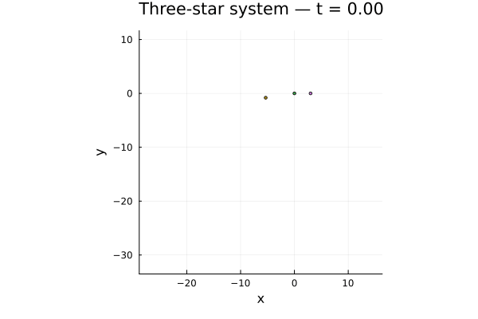

## Example: gravitational three-body problem
~~~
<figure id="threebody" style="float: right; width: 100%">

<figcaption>Gravitational three-body problem.</figcaption>
</figure>
~~~
I thought a good example for you would be the gravitational three-body problem. As like the double pendulum problem, it exhibits chaos. Further, it is the premise of a popular scifi series, The Three Body Problem. Our axes are selected such that the mass $M$ is centred at the origin. Consequently, the central mass does not move on our axes. So only the two other masses contribute to our kinetic energy:
\begin{align*}
T &= \dfrac{m_1}{2}(\dot{r}_1^2 + r_1^2 \dot{\theta}_1^2) + \dfrac{m_2}{2}(\dot{r}_2^2+r_2^2\dot{\theta}_2^2).
\end{align*}
To calculate the potential energy, we will need to calculate $r_{12}$, the distance between the masses $m_1$ and $m_2$. To calculate this, we will start with the $x$ and $y$ coordinates for the two masses:
\begin{align*}
x_1 &= r_1\cos{\theta_1}\\
y_1 &= r_1 \sin{\theta_1} \\
x_2 &= r_2 \cos{\theta_2} \\
y_2 &= r_2 \sin{\theta_2}.
\end{align*}
Hence the difference in $x$ is $r_2\cos{\theta_2} - r_1\cos{\theta_1}$ and the difference in $y$ is $r_2\sin{\theta_2}-r_1\sin{\theta_1}$. Hence:
\begin{align*}
r_{12}^2 &= (r_2\cos{\theta_2} - r_1\cos{\theta_1})^2 + (r_2\sin{\theta_2} - r_1\sin{\theta_1})^2 \\
&= r_2^2 \cos^2{\theta_2} + r_1^2 \cos^2{\theta_1} -2r_1 r_2 \cos{\theta_1}\cos{\theta_2} + r_2^2 \sin^2{\theta_2} + r_1^2\sin^2{\theta_1}-2r_1r_2 \sin{\theta_1}\sin{\theta_2} \\
&= r_1^2 + r_2^2 - 2r_1 r_2 \cos{(\theta_2-\theta_1)} \\
\therefore r_{12} &= \sqrt{r_1^2 + r_2^2 - 2r_1 r_2 \cos{(\theta_2-\theta_1)}}.
\end{align*}
Hence the gravitational potential energy of our system:
\begin{align*}
V &= -\dfrac{GMm_1}{r_1} - \dfrac{GMm_2}{r_2} - \dfrac{Gm_1m_2}{r_{12}}.
\end{align*}
Hence the Lagrangian is:
\begin{align}
L &= T - V \\
&= \dfrac{m_1}{2}(\dot{r}_1^2 + r_1^2 \dot{\theta}_1^2) + \dfrac{m_2}{2}(\dot{r}_2^2+r_2^2\dot{\theta}_2^2) + \dfrac{GMm_1}{r_1} + \dfrac{GMm_2}{r_2} + \dfrac{Gm_1m_2}{r_{12}}.
\end{align}
We will calculate $\dfrac{\partial r_{12}}{\partial q_i}$ as this will come in handy when finding $\dfrac{\partial L}{\partial q_i}$.
\begin{align*}
\dfrac{\partial r_{12}}{\partial r_1} &= \dfrac{2r_1-2r_2\cos{(\theta_2-\theta_1)}}{2\sqrt{r_1^2 + r_2^2 - 2r_1 r_2 \cos{(\theta_2-\theta_1)}}} \\
&= \dfrac{r_1-r_2\cos{(\theta_2-\theta_1)}}{\sqrt{r_1^2 + r_2^2 - 2r_1 r_2 \cos{(\theta_2-\theta_1)}}} \\
&= \dfrac{r_1-r_2\cos{(\theta_2-\theta_1)}}{r_{12}}\\
\dfrac{\partial r_{12}}{\partial r_2} &= \dfrac{r_2-r_1\cos{(\theta_2-\theta_1)}}{r_{12}}\\
\dfrac{\partial r_{12}}{\partial \theta_1} &= \dfrac{-2r_1r_2\sin{(\theta_2-\theta_1)}}{2r_{12}}\\
&= \dfrac{-r_1r_2\sin{(\theta_2-\theta_1)}}{r_{12}} \\
\dfrac{\partial r_{12}}{\partial \theta_2} &= \dfrac{2r_1r_2\sin{(\theta_2-\theta_1)}}{2r_{12}}\\
&= \dfrac{r_1r_2\sin{(\theta_2-\theta_1)}}{r_{12}}.
\end{align*}
The momentum canonical to $r_1$ is:
\begin{align*}
p_{r_1} &= \dfrac{\partial L}{\partial \dot{r}_1} \\
&= m_1 \dot{r}_1 \\
p_{r_2} &= \dfrac{\partial L}{\partial \dot{r}_2} \\
&= m_2 \dot{r}_2 \\
p_{\theta_1} &= \dfrac{\partial L}{\partial \dot{\theta}_1} \\
&= m_1 r_1^2\dot{\theta}_1 \\
p_{\theta_2} &= \dfrac{\partial L}{\partial \dot{\theta}_2} \\
&= m_2 r_2^2 \dot{\theta}_2.
\end{align*}
As for the spatial derivatives of $L$:
\begin{align*}
\dfrac{\partial L}{\partial r_1} &= m_1 r_1 \dot{\theta}_1^2 - \dfrac{GMm_1}{r_1^2} - \dfrac{Gm_1 m_2( r_1-r_2 \cos{(\theta_2-\theta_1)})}{r_{12}^3}\\
\dfrac{\partial L}{\partial r_2} &= m_2 r_2 \dot{\theta}_2^2 - \dfrac{GMm_2}{r_2^2} - \dfrac{Gm_1 m_2( r_2-r_1 \cos{(\theta_2-\theta_1)})}{r_{12}^3}\\
\dfrac{\partial L}{\partial \theta_1} &= -\dfrac{Gm_1 m_2 r_1r_2\sin{(\theta_2-\theta_1)}}{r_{12}^3}\\
\dfrac{\partial L}{\partial \theta_2} &= \dfrac{Gm_1 m_2r_1r_2\sin{(\theta_2-\theta_1)}}{r_{12}^3}.
\end{align*}
Hence the $r_1$ Euler-Lagrange equation is:
\begin{align*}
m_1 \ddot{r}_1 &= m_1 r_1 \dot{\theta}_1^2 - \dfrac{GMm_1}{r_1^2} - \dfrac{Gm_1 m_2( r_1-r_2 \cos{(\theta_2-\theta_1)})}{r_{12}^3} \\
\ddot{r}_1 &= r_1 \dot{\theta}_1^2 - \dfrac{GM}{r_1^2} - \dfrac{Gm_2( r_1-r_2 \cos{(\theta_2-\theta_1)})}{r_{12}^3}.
\end{align*}
Hence the $r_2$ Euler-Lagrange equation is:
\begin{align*}
m_2 \ddot{r}_2 &= m_2 r_2 \dot{\theta}_2^2 - \dfrac{GMm_2}{r_2^2} - \dfrac{Gm_1 m_2( r_2-r_1 \cos{(\theta_2-\theta_1)})}{r_{12}^3} \\
\ddot{r}_2 &= r_2 \dot{\theta}_2^2 - \dfrac{GM}{r_2^2} - \dfrac{Gm_1( r_2-r_1 \cos{(\theta_2-\theta_1)})}{r_{12}^3}.
\end{align*}
As for the $\theta_1$ Euler-Lagrange equation, it is:
\begin{align*}
2m_1 r_1\dot{r}_1 \dot{\theta}_1 + m_1 r_1^2 \ddot{\theta}_1 &= -\dfrac{Gm_1 m_2 r_1r_2\sin{(\theta_2-\theta_1)}}{r_{12}^3}
\end{align*}
divide both sides by $m_1r_1^2$:
\begin{align*}
\dfrac{2\dot{r}_1 \dot{\theta}_1}{r_1} + \ddot{\theta}_1 &= -\dfrac{Gm_2 r_2\sin{(\theta_2-\theta_1)}}{r_1 r_{12}^3} \\
\ddot{\theta}_1 &= -\dfrac{2\dot{r}_1 \dot{\theta}_1}{r_1} -\dfrac{Gm_2 r_2\sin{(\theta_2-\theta_1)}}{r_1 r_{12}^3}.
\end{align*}
As for $\theta_2$:
\begin{align*}
2m_2 r_2\dot{r}_2 \dot{\theta}_2 + m_2 r_2^2 \ddot{\theta}_2 &= \dfrac{Gm_1 m_2 r_1r_2\sin{(\theta_2-\theta_1)}}{r_{12}^3}.
\end{align*}
Dividing both sides by $m_2r_2^2$:
\begin{align*}
\dfrac{2\dot{r}_2 \dot{\theta}_2}{r_2} + \ddot{\theta}_2 &= \dfrac{Gm_1 r_1\sin{(\theta_2-\theta_1)}}{r_2 r_{12}^3} \\
\ddot{\theta}_2 &= -\dfrac{2\dot{r}_2 \dot{\theta}_2}{r_2} +\dfrac{Gm_1 r_1\sin{(\theta_2-\theta_1)}}{r_2 r_{12}^3}.
\end{align*}

```julia:./code/threebody
using DifferentialEquations
using Plots
using Printf

# ============================================================
# Three-star gravitational system
#
# Star M is fixed at the origin.
# Stars m₁ and m₂ orbit M while also perturbing one another.
#
# Unlike a strongly hierarchical system, the masses here are
# comparable enough for the mutual interaction to produce
# strongly non-Keplerian and potentially chaotic motion.
#
# Units are normalised:
#   G = 1
#   mass = arbitrary mass unit
#   distance = arbitrary distance unit
#   time = corresponding dynamical time unit
# ============================================================

# ------------------------------------------------------------
# Parameters
# ------------------------------------------------------------

G = 1.0

M  = 5.0
m₁ = 1.0
m₂ = 1.0

fps = 60

# ------------------------------------------------------------
# Initial approximate Keplerian orbits
# ------------------------------------------------------------

# The two orbits are deliberately much less hierarchical than
# in the previous version. This makes the mutual perturbation
# strong enough to destroy the simple Keplerian behaviour.

a₁ = 5.0
e₁ = 0.40

a₂ = 9.0
e₂ = 0.40

# Periapsis distances

r₁₀ = a₁ * (1 - e₁)
r₂₀ = a₂ * (1 - e₂)

# ------------------------------------------------------------
# Initial angular positions
# ------------------------------------------------------------

# Start on opposite sides of the central star. A small
# asymmetry is introduced so that the system does not remain
# artificially symmetric.

θ₁₀ = 0.0
θ₂₀ = π + 0.15

# ------------------------------------------------------------
# Initial Keplerian periapsis velocities
# ------------------------------------------------------------

v₁₀ = sqrt(G * M * (1 + e₁) / r₁₀)
v₂₀ = sqrt(G * M * (1 + e₂) / r₂₀)

# Radial velocity is zero at periapsis.

ṙ₁₀ = 0.0
ṙ₂₀ = 0.0

# Since v = r θ̇:

θ̇₁₀ = v₁₀ / r₁₀
θ̇₂₀ = v₂₀ / r₂₀

# ------------------------------------------------------------
# Initial state vector
#
# u = [
#     r₁,
#     r₂,
#     θ₁,
#     θ₂,
#     ṙ₁,
#     ṙ₂,
#     θ̇₁,
#     θ̇₂
# ]
# ------------------------------------------------------------

u₀ = [
    r₁₀,
    r₂₀,
    θ₁₀,
    θ₂₀,
    ṙ₁₀,
    ṙ₂₀,
    θ̇₁₀,
    θ̇₂₀
]

# ------------------------------------------------------------
# Equations of motion
# ------------------------------------------------------------

function three_star!(du, u, p, t)

    r₁, r₂, θ₁, θ₂, ṙ₁, ṙ₂, θ̇₁, θ̇₂ = u

    Δθ = θ₂ - θ₁

    r₁₂ = sqrt(
        r₁^2 +
        r₂^2 -
        2*r₁*r₂*cos(Δθ)
    )

    # --------------------------------------------------------
    # Radial accelerations
    # --------------------------------------------------------

    r̈₁ =
        r₁*θ̇₁^2 -
        G*M/r₁^2 -
        G*m₂*(r₁ - r₂*cos(Δθ))/r₁₂^3

    r̈₂ =
        r₂*θ̇₂^2 -
        G*M/r₂^2 -
        G*m₁*(r₂ - r₁*cos(Δθ))/r₁₂^3

    # --------------------------------------------------------
    # Angular accelerations
    # --------------------------------------------------------

    θ̈₁ =
        -2*ṙ₁*θ̇₁/r₁ -
        G*m₂*r₂*sin(Δθ)/(r₁*r₁₂^3)

    θ̈₂ =
        -2*ṙ₂*θ̇₂/r₂ +
        G*m₁*r₁*sin(Δθ)/(r₂*r₁₂^3)

    # --------------------------------------------------------
    # First-order system
    # --------------------------------------------------------

    du[1] = ṙ₁
    du[2] = ṙ₂
    du[3] = θ̇₁
    du[4] = θ̇₂

    du[5] = r̈₁
    du[6] = r̈₂
    du[7] = θ̈₁
    du[8] = θ̈₂
end

# ------------------------------------------------------------
# Stop if the two orbiting stars get extremely close
# ------------------------------------------------------------

minimum_separation = 1.6

function separation_condition(u, t, integrator)

    r₁ = u[1]
    r₂ = u[2]
    θ₁ = u[3]
    θ₂ = u[4]

    sqrt(
        r₁^2 +
        r₂^2 -
        2*r₁*r₂*cos(θ₂ - θ₁)
    ) - minimum_separation
end

function stop_simulation!(integrator)
    terminate!(integrator)
end

separation_callback = ContinuousCallback(
    separation_condition,
    stop_simulation!,
    nothing
)

# ------------------------------------------------------------
# Integrate
#
# 200 time units gives the system ample time to undergo
# several orbital periods and develop strongly perturbed
# trajectories.
# ------------------------------------------------------------

tspan = (0.0, 100.0)

prob = ODEProblem(
    three_star!,
    u₀,
    tspan
)

sol = solve(
    prob,
    Vern8(),
    callback=separation_callback,
    saveat=15/fps,
    abstol=1e-10,
    reltol=1e-10
)

# ------------------------------------------------------------
# Convert polar coordinates to Cartesian coordinates
# ------------------------------------------------------------

x₁ = sol[1, :] .* cos.(sol[3, :])
y₁ = sol[1, :] .* sin.(sol[3, :])

x₂ = sol[2, :] .* cos.(sol[4, :])
y₂ = sol[2, :] .* sin.(sol[4, :])

# ------------------------------------------------------------
# Calculate star-star separation
# ------------------------------------------------------------

separation = sqrt.(
    (x₂ .- x₁).^2 +
    (y₂ .- y₁).^2
)

# ------------------------------------------------------------
# Estimate number of angular revolutions
# ------------------------------------------------------------

θ₁_unwrapped = unwrap(sol[3, :])
θ₂_unwrapped = unwrap(sol[4, :])

# ------------------------------------------------------------
# Estimate number of angular revolutions
# ------------------------------------------------------------

orbits₁ = (sol[3, end] - sol[3, 1]) / (2π)
orbits₂ = (sol[4, end] - sol[4, 1]) / (2π)

println(
    "Approximate revolutions of star 1: ",
    @sprintf("%.2f", orbits₁)
)

println(
    "Approximate revolutions of star 2: ",
    @sprintf("%.2f", orbits₂)
)

println(
    "Minimum star-star separation: ",
    @sprintf("%.3f", minimum(separation))
)

# ------------------------------------------------------------
# Plot limits
# ------------------------------------------------------------

x_all = vcat(0.0, x₁, x₂)
y_all = vcat(0.0, y₁, y₂)

xmin = minimum(x_all)
xmax = maximum(x_all)
ymin = minimum(y_all)
ymax = maximum(y_all)

span = max(
    xmax - xmin,
    ymax - ymin
)

margin = 0.08 * span

xc = (xmin + xmax) / 2
yc = (ymin + ymax) / 2

xmin = xc - span/2 - margin
xmax = xc + span/2 + margin

ymin = yc - span/2 - margin
ymax = yc + span/2 + margin

# ------------------------------------------------------------
# Animation
# ------------------------------------------------------------

anim = @animate for i in eachindex(sol.t)

    plot(
        x₁[1:i],
        y₁[1:i],
        linewidth=1.5,
        label=false,
        xlims=(xmin, xmax),
        ylims=(ymin, ymax),
        aspect_ratio=:equal,
        xlabel="x",
        ylabel="y",
        title="Three-star system — t = $(@sprintf("%.2f", sol.t[i]))"
    )

    plot!(
        x₂[1:i],
        y₂[1:i],
        linewidth=1.5,
        label=false
    )

    # Central star.
    #
    # Small markers are used deliberately so that the plotted
    # marker size does not imply a physical stellar radius.

    scatter!(
        [0.0],
        [0.0],
        markersize=5,
        label=false
    )

    # Star 1

    scatter!(
        [x₁[i]],
        [y₁[i]],
        markersize=2,
        label=false
    )

    # Star 2

    scatter!(
        [x₂[i]],
        [y₂[i]],
        markersize=2,
        label=false
    )
end

# ------------------------------------------------------------
# Save GIF
#
# saveat = 1/fps
# fps    = fps
#
# Therefore one simulated second corresponds to one second
# of animation playback.
# ------------------------------------------------------------

gif(
    anim,
    "three_star_system.gif",
    fps=fps
)

# ------------------------------------------------------------
# Summary
# ------------------------------------------------------------

println()
println("Simulation finished.")
println(
    "Final simulation time: ",
    @sprintf("%.2f", sol.t[end])
)
println("Number of frames: ", length(sol.t))
```

The above Julia code produces the animation below.

~~~
<figure id="threebodyan" style="float: right; width: 100%">

<figcaption>A three star system simulation.</figcaption>
</figure>
~~~