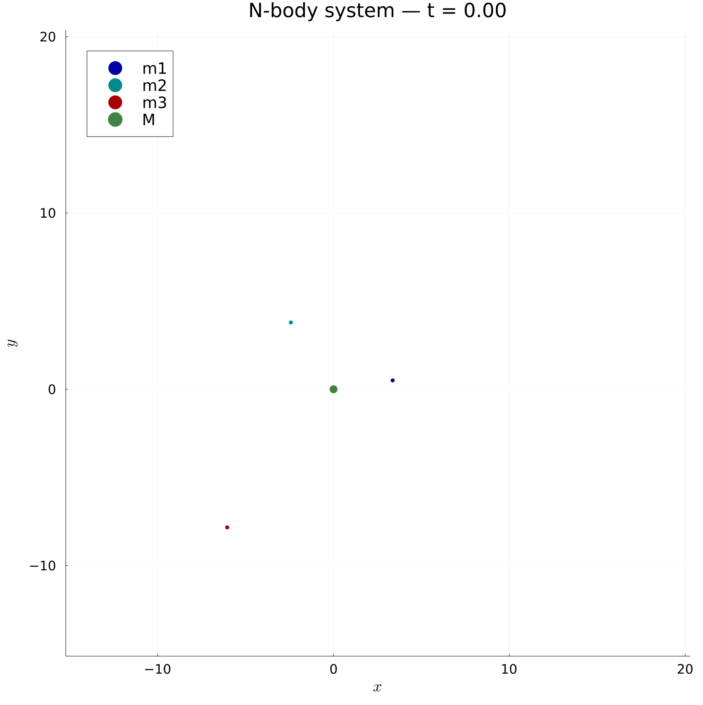

### Gravitational $n$-body problem
In this section, we will try to generalize our Lagrangian and system of equations from the previous section so that they are applicable to a gravitational system with an arbitrary number of bodies. Let $M$ denote the static central mass, $m_i$ the $i$th moving mass, $r_i$ the distance from the central mass to the $i$th moving mass, $\theta_i$ is the angle between the line formed by $r_i$ and the positive $x$-axis, measured counter-clockwise. Which is essentially how we defined things in Figure \figref{threebody}.

So kinetic energy for this system should be pretty straight forward, namely it should simply be the sum of the kinetic energy of each individual body, in other words it should be:
\begin{align*}
T &= \sum_{i=1}^{n-1} \dfrac{m_i(\dot{r}_i^2+r_i^2\dot{\theta}_i^2)}{2}.
\end{align*}
Where $m_i$ is the $i$th moving body. As for potential energy, well there will be terms for the interaction between each of the $n$ bodies. For interactions between the central mass and the moving bodies, these will simply be of the form $-\dfrac{GMm_i}{r_i}$. As for the interactions between the moving bodies, their potential energy terms will be of the form $-\dfrac{Gm_i m_j}{r_{ij}}$ where $r_{ij}$ is the distance between masses $i$ and $j$. Hence:
\begin{align*}
x_i &= r_i \cos{\theta_i},\hspace{0.2cm}x_j &= r_j \cos{\theta_j} \\
y_i &= r_i \sin{\theta_i},\hspace{0.2cm}y_j &= r_j \sin{\theta_j}.
\end{align*}
Let us define the change in $x$ between masses $i$ and $j$ as $\Delta x_{ij}$ and the corresponding change in $y$ is $\Delta y_{ij}$. 
\begin{align*}
\Delta x_{ij} &= r_j \cos{\theta_j} - r_i \cos{\theta_i} \\
\Delta x_{ij}^2 &= r_j^2 \cos^2{\theta_j} + r_i^2\cos^2{\theta_i} - 2r_ir_j \cos{\theta_i}\cos{\theta_j} \\
\Delta y_{ij} &= r_j \sin{\theta_j} - r_i \sin{\theta_i} \\
\Delta y_{ij}^2 &= r_j^2 \sin^2{\theta_j} + r_i^2\sin^2{\theta_i} - 2r_ir_j \sin{\theta_i}\sin{\theta_j} \\
\therefore r_{ij}^2 &= \Delta x_{ij}^2 + \Delta y_{ij}^2 \\
&= r_j^2 \cos^2{\theta_j} + r_i^2\cos^2{\theta_i} - 2r_ir_j \cos{\theta_i}\cos{\theta_j} + r_j^2 \sin^2{\theta_j} + r_i^2\sin^2{\theta_i} - 2r_ir_j \sin{\theta_i}\sin{\theta_j} \\
&= r_i^2 (\cos^2{\theta_i}+\sin^2{\theta_i}) + r_j^2 (\cos^2{\theta_j}+\sin^2{\theta_j}) - 2r_i r_j (\cos{\theta_i}\cos{\theta_j} + \sin{\theta_i}\sin{\theta_j}) \\
&= r_i^2 + r_j^2 - 2r_i r_j \cos{(\theta_j-\theta_i)} \\
\therefore r_{ij} &= \sqrt{r_i^2 + r_j^2 - 2r_i r_j \cos{(\theta_j-\theta_i)}}.
\end{align*}
As we can see, $r_{ij} = r_{ji}$ due to cosine being an event function. Hence the potential energy is:
\begin{align*}
V &= -\sum_{i=1}^{n-1} \left(\dfrac{GMm_i}{r_i} - \sum_{j>i}^{n-1} \dfrac{Gm_i m_j}{r_{ij}}\right).
\end{align*}
Hence:
\begin{align*}
L &= \sum_{i=1}^{n-1} \left(\dfrac{m_i (\dot{r}_i^2 + r_i^2 \dot{\theta}_i^2)}{2} + \dfrac{GMm_i}{r_i} + \sum_{j>i}^{n-1} \dfrac{Gm_i m_j}{r_{ij}}\right)
\end{align*}
Next we will calculate $\dfrac{\partial r_{ij}}{\partial q_k}$:
\begin{align*}
\dfrac{\partial r_{ij}}{\partial r_k} &= \dfrac{2r_i \delta{ik} + 2r_j \delta_{jk} - 2(\delta_{ik}r_j + r_i \delta_{jk})\cos{(\theta_j-\theta_i)}}{2r_{ij}} \\
&= \dfrac{r_i \delta{ik} + r_j \delta_{jk} - (\delta_{ik}r_j + r_i \delta_{jk})\cos{(\theta_j-\theta_i)}}{r_{ij}} \\
\dfrac{\partial r_{ij}}{\partial \theta_k} &= \dfrac{2r_i r_j\sin{(\theta_j-\theta_i)}(\delta_{jk}-\delta_{ik})}{2r_{ij}} \\
&= \dfrac{r_i r_j\sin{(\theta_j-\theta_i)}(\delta_{jk}-\delta_{ik})}{r_{ij}}.
\end{align*}
Hence the canonical momentum for $r_k$ is:
\begin{align*}
p_{r_k} &= \dfrac{\partial L}{\partial \dot{r}_k} \\
&= \sum_{i=1}^{n-1} \left(\dfrac{m_i (2\dot{r}_i \delta_{ik})}{2}\right) \\
&= m_k \dot{r}_k.
\end{align*}
Hence:
\begin{align*}
\dot{p}_{r_k} &= m_k \ddot{r}_k.
\end{align*}
As for the canonical momentum for $\theta_k$, it is:
\begin{align*}
p_{r_k} &= \dfrac{\partial L}{\partial \dot{\theta}_k} \\
&= \sum_{i=1}^{n-1} \left(\dfrac{m_i (2r_i^2 \dot{\theta}_i \delta_{ik})}{2}\right) \\
&= m_k r_k^2 \dot{\theta}_k \\
\therefore \dot{p}_{r_k} &= 2m_k r_k \dot{r_k} \dot{\theta}_k + m r_k^2 \ddot{\theta}_k.
\end{align*}
As for $\dfrac{\partial L}{\partial q_k}$:
\begin{align*}
\dfrac{\partial L}{\partial r_k} &= \sum_{i=1}^{n-1} \left(\dfrac{m_i (2r_i\delta_{ik} \dot{\theta}_i^2)}{2} - \dfrac{GMm_i\delta_{ik}}{r_i^2} - \sum_{j>i}^{n-1} \dfrac{Gm_i m_j\left(r_i \delta_{ik} + r_j \delta_{jk} - (\delta_{ik}r_j + r_i \delta_{jk})\cos{(\theta_j-\theta_i)}\right)}{r_{ij}^3}\right)\\
&= m_k r_k \dot{\theta}_k^2 - \dfrac{GMm_k}{r_k^2} - \sum_{i=1}^{n-1}\sum_{j>i}^{n-1} \dfrac{Gm_i m_j\left(r_i \delta_{ik} + r_j \delta_{jk} - (\delta_{ik}r_j + r_i \delta_{jk})\cos{(\theta_j-\theta_i)}\right)}{r_{ij}^3}.
\end{align*}
Let us work on the final double sum. Factoring out the Kronecker deltas with like indices:
\begin{align*}
\sum_{i=1}^{n-1}\sum_{j>i}^{n-1} \dfrac{Gm_i m_j\left(r_i \delta_{ik} + r_j \delta_{jk} - (\delta_{ik}r_j + r_i \delta_{jk})\cos{(\theta_j-\theta_i)}\right)}{r_{ij}^3} &= \sum_{i=1}^{n-1}\sum_{j>i}^{n-1} \dfrac{Gm_i m_j\left[\delta_{ik}(r_i - r_j \cos{(\theta_j-\theta_i)} )+ \delta_{jk}(r_j -r_i \cos{(\theta_j-\theta_i)})\right]}{r_{ij}^3}.
\end{align*}
The $\delta_{ik}$ imposes that $i=k$, since $j>i$ we get $j=k+1, k+2, k+3, ...,  n-1$. So we are left only with the $j$ sum. As for $\delta_{jk}$, it imposes that $j=k$ which then requires, given $j>i$ that $i=1,2,3,...,k-1$. 
\begin{align*}
\sum_{i=1}^{n-1}\sum_{j>i}^{n-1} \dfrac{Gm_i m_j\left[\delta_{ik}(r_i - r_j \cos{(\theta_j-\theta_i)} )+ \delta_{jk}(r_j -r_i \cos{(\theta_j-\theta_i)})\right]}{r_{ij}^3} &= \sum_{j=k+1}^{n-1} \dfrac{Gm_{k}m_j (r_k-r_j\cos{(\theta_j-\theta_k)})}{r_{kj}^3} + \sum_{i=1}^{k-1} \dfrac{Gm_{i}m_k (r_k-r_i\cos{(\theta_k-\theta_i)})}{r_{ik}^3}.
\end{align*}
We can combine these sums into one, as $r_{ij}=r_{ji}$ and $\cos{(\theta_j-\theta_i)}=\cos{(\theta_i-\theta_j)}$:
\begin{align*}
\sum_{j=k+1}^{n-1} \dfrac{Gm_{k}m_j (r_k-r_j\cos{(\theta_j-\theta_k)})}{r_{kj}^3} + \sum_{i=1}^{k-1} \dfrac{Gm_{i}m_k (r_k-r_i\cos{(\theta_k-\theta_i)})}{r_{ik}^3} &= \sum_{\substack{i=1 \\ i\neq k}}^{n-1} \dfrac{Gm_{i}m_k (r_k-r_i\cos{(\theta_k-\theta_i)})}{r_{ik}^3}.
\end{align*}
Hence $\dfrac{\partial L}{\partial r_k}$ becomes:
\begin{align*}
\dfrac{\partial L}{\partial r_k} &= m_k r_k \dot{\theta}_k^2 - \dfrac{GMm_k}{r_k^2} - \sum_{\substack{i=1 \\ i\neq k}}^{n-1} \dfrac{Gm_{i}m_k (r_k-r_i\cos{(\theta_k-\theta_i)})}{r_{ik}^3}.
\end{align*}
Hence the $r_k$ equation of motion is:
\begin{align*}
m_k\ddot{r}_k &= m_k r_k \dot{\theta}_k^2 - \dfrac{GMm_k}{r_k^2} - \sum_{\substack{i=1 \\ i\neq k}}^{n-1} \dfrac{Gm_{i}m_k (r_k-r_i\cos{(\theta_k-\theta_i)})}{r_{ik}^3}.
\end{align*}
Dividing by $m_k$ yields:
\begin{align*}
\ddot{r}_k &= r_k \dot{\theta}_k^2 - \dfrac{GM}{r_k^2} - \sum_{\substack{i=1 \\ i\neq k}}^{n-1} \dfrac{Gm_{i} (r_k-r_i\cos{(\theta_k-\theta_i)})}{r_{ik}^3}.
\end{align*}
As for $\theta_k$, the canonical momentum and its time derivative are:
\begin{align*}
p_{\theta_k} &= \dfrac{\partial L}{\partial \dot{\theta}_k} \\
&= \sum_{i=1}^{n-1} \left(\dfrac{2m_i r_i^2 \dot{\theta}_i \delta_{ik}}{2}\right) \\
&= m_k r_k^2 \dot{\theta}_k \\
\dot{p}_{\theta_k} &= 2m_kr_k \dot{r}_k \dot{\theta}_k + mr_k^2 \ddot{\theta}_k.
\end{align*}
As for the other component of Equations \eqref{ELE}:
\begin{align*}
\dfrac{\partial L}{\partial \theta_k} &= -\sum_{i=1}^{n-1} \sum_{j>i}^{n-1} \dfrac{Gm_im_j}{r_{ij}^2} \dfrac{\partial r_{ij}}{\partial \theta_k} \\
&= -\sum_{i=1}^{n-1} \sum_{j>i}^{n-1} \dfrac{Gm_im_jr_i r_j\sin{(\theta_j-\theta_i)}(\delta_{jk}-\delta_{ik})}{r_{ij}^3} \\
&= \sum_{j=k+1}^{n-1}\dfrac{Gm_k m_jr_k r_j\sin{(\theta_j-\theta_k)}}{r_{kj}^3} - \sum_{i=1}^{k-1} \dfrac{Gm_i m_kr_i r_k\sin{(\theta_k-\theta_i)}}{r_{ik}^3} \\
&= \sum_{\substack{i=1\\ i\neq k}}^{n-1} \dfrac{Gm_i m_kr_i r_k\sin{(\theta_i-\theta_k)}}{r_{ik}^3}.
\end{align*}
Hence the Euler-Lagrange equations for $\theta_k$ can be expressed as:
\begin{align*}
2m_kr_k \dot{r}_k \dot{\theta}_k + mr_k^2 \ddot{\theta}_k &= \sum_{i=1}^{n-1} \dfrac{Gm_i m_kr_i r_k\sin{(\theta_i-\theta_k)}}{r_{ik}^3}.
\end{align*}
Dividing both sides by $mr_k^2$ yields:
\begin{align*}
\dfrac{2\dot{r}_k\dot{\theta}_k}{r_k} + \ddot{\theta}_k &= \sum_{i=1}^{n-1} \dfrac{Gm_i r_i \sin{(\theta_i-\theta_k)}}{r_k r_{ik}^3}.
\end{align*}
Moving the first term on the left-hand side to the right-hand side yields:
\begin{align*}
\ddot{\theta}_k &= -\dfrac{2\dot{r}_k\dot{\theta}_k}{r_k} + \sum_{i=1}^{n-1} \dfrac{Gm_i r_i \sin{(\theta_i-\theta_k)}}{r_k r_{ik}^3}.
\end{align*}

```julia:./code/nbody
using DifferentialEquations
using Plots, Measures, Colors
using Printf, LaTeXStrings

# ============================================================
# N-body gravitational system with a fixed central mass
#
# M is fixed at the origin.
# N orbiting bodies interact gravitationally with M and with
# one another.
#
# State vector:
# u = [r₁,...,rₙ, θ₁,...,θₙ, ṙ₁,...,ṙₙ, θ̇₁,...,θ̇ₙ]
#
# All quantities use normalized units.
# ============================================================

# ------------------------------------------------------------
# Parameters
# ------------------------------------------------------------

G = 1.0
M = 3.0

# Add or remove entries to change the number of orbiting bodies.
# All parameter vectors must have the same length.

masses = [1.5, 1.5, 0.01]

a = [4.0, 5.0, 10.0]
e = [0.15, 0.10, 0.01]

# Simulation settings

tspan = (0.0, 200.0)

abstol = 1e-11
reltol = 1e-11

fps = 60
stepsize = 30/fps

marksize = 10

legendfontsize = 24
guidefontsize = 24
tickfontsize = 20
titlefontsize = 30

# ------------------------------------------------------------
# Validate parameters
# ------------------------------------------------------------

N = length(masses)

@assert N >= 1 "At least one orbiting body is required."
@assert length(a) == N "The semimajor axis vector must have N entries."
@assert length(e) == N "The eccentricity vector must have N entries."
@assert all(>(0), masses) "All orbiting masses must be positive."
@assert all(>(0), a) "All semimajor axes must be positive."
@assert all(x -> 0 <= x < 1, e) "Eccentricities must satisfy 0 ≤ e < 1."

# ------------------------------------------------------------
# Initial approximate Keplerian orbits
# ------------------------------------------------------------

# Periapsis distances

r₀ = a .* (1 .- e)

# Initial angular positions.
#
# Bodies are approximately evenly distributed around M.
# A small perturbation breaks exact rotational symmetry.

θ₀ = [
    2π*(k-1)/N + 0.15*sin(sqrt(2)*k)
    for k in 1:N
]

# Initial Keplerian periapsis velocities

v₀ = sqrt.(G .* M .* (1 .+ e) ./ r₀)

# Radial velocities vanish at periapsis.

ṙ₀ = zeros(N)

# Since v = r θ̇:

θ̇₀ = v₀ ./ r₀

# ------------------------------------------------------------
# Initial state vector
# ------------------------------------------------------------

u₀ = vcat(
    r₀,
    θ₀,
    ṙ₀,
    θ̇₀
)

# ------------------------------------------------------------
# Equations of motion
# ------------------------------------------------------------

function n_body!(du, u, p, t)

    G, M, masses, N = p

    # Obtain views of the state vector.

    r  = @view u[1:N]
    θ  = @view u[N+1:2N]
    ṙ = @view u[2N+1:3N]
    θ̇ = @view u[3N+1:4N]

    # Obtain views of the derivative vector.

    dr  = @view du[1:N]
    dθ  = @view du[N+1:2N]
    dṙ = @view du[2N+1:3N]
    dθ̇ = @view du[3N+1:4N]

    # First-order kinematic equations.

    dr .= ṙ
    dθ .= θ̇

    # --------------------------------------------------------
    # Gravitational accelerations
    # --------------------------------------------------------

    for k in 1:N

        # Angular differences relative to body k.

        Δθ = θ .- θ[k]

        # Distances between body k and every other body.

        rᵢₖ = sqrt.(
            r[k]^2 .+
            r.^2 .-
            2 .* r[k] .* r .* cos.(Δθ)
        )

        # Exclude self-interaction.

        rᵢₖ[k] = Inf

        # ----------------------------------------------------
        # Radial acceleration
        # ----------------------------------------------------

        radial_interaction = sum(
            masses .* (
                r[k] .- r .* cos.(Δθ)
            ) ./ rᵢₖ.^3
        )

        r̈ₖ =
            r[k]*θ̇[k]^2 -
            G*M/r[k]^2 -
            G*radial_interaction

        # ----------------------------------------------------
        # Angular acceleration
        # ----------------------------------------------------

        angular_interaction = sum(
            masses .* r .* sin.(Δθ) ./ rᵢₖ.^3
        )

        θ̈ₖ =
            -2*ṙ[k]*θ̇[k]/r[k] +
            G*angular_interaction/r[k]

        dṙ[k] = r̈ₖ
        dθ̇[k] = θ̈ₖ

    end
end

# ------------------------------------------------------------
# Integrate
# ------------------------------------------------------------

p = (G, M, masses, N)

prob = ODEProblem(
    n_body!,
    u₀,
    tspan,
    p
)

solut = solve(
    prob,
    Vern8(),
    saveat=stepsize,
    abstol=abstol,
    reltol=reltol
)

# ------------------------------------------------------------
# Convert polar coordinates to Cartesian coordinates
# ------------------------------------------------------------

x = [
    solut[k, :] .* cos.(solut[N+k, :])
    for k in 1:N
]

y = [
    solut[k, :] .* sin.(solut[N+k, :])
    for k in 1:N
]

# ------------------------------------------------------------
# Calculate pairwise separations
# ------------------------------------------------------------

separations = Dict{Tuple{Int,Int},Vector{Float64}}()

for k in 1:N-1
    for i in k+1:N

        separations[(k,i)] = sqrt.(
            (x[k] .- x[i]).^2 .+
            (y[k] .- y[i]).^2
        )

    end
end

# ------------------------------------------------------------
# Plot limits
# ------------------------------------------------------------

x_all = vcat([0.0], x...)
y_all = vcat([0.0], y...)

xmin = minimum(x_all)
xmax = maximum(x_all)
ymin = minimum(y_all)
ymax = maximum(y_all)

span = max(xmax - xmin, ymax - ymin)

margin = 0.08 * span

xc = (xmin + xmax)/2
yc = (ymin + ymax)/2

xmin = xc - span/2 - margin
xmax = xc + span/2 + margin

ymin = yc - span/2 - margin
ymax = yc + span/2 + margin

# ------------------------------------------------------------
# Colours
# ------------------------------------------------------------

palette = [
    RGB(0.0, 0.0, 0.65),   # Dark blue
    RGB(0.0, 0.55, 0.55),  # Dark teal
    RGB(0.65, 0.0, 0.0),   # Dark red
    RGB(0.45, 0.0, 0.65),  # Purple
    RGB(0.0, 0.45, 0.15),  # Dark green
    RGB(0.65, 0.25, 0.0),  # Dark orange
    RGB(0.25, 0.25, 0.25), # Dark grey
    RGB(0.0, 0.4, 0.65)    # Steel blue
]

bodycolors = [palette[mod1(k, length(palette))] for k in 1:N]

centralcolor = RGB24(65/255, 130/255, 65/255)

# ------------------------------------------------------------
# Animation
# ------------------------------------------------------------

anim = @animate for frame in eachindex(solut.t)

    p = plot(
        xlims=(xmin, xmax),
        ylims=(ymin, ymax),
        aspect_ratio=:equal,
        xlabel=L"x",
        ylabel=L"y",
        title="N-body system — t = $(@sprintf("%.2f", solut.t[frame]))",
        guidefontsize=guidefontsize,
        tickfontsize=tickfontsize,
        titlefontsize=titlefontsize,
        legend=:topleft,
        legendfontsize=legendfontsize,
        left_margin=2Plots.mm,
        right_margin=2Plots.mm,
        top_margin=2Plots.mm,
        bottom_margin=2Plots.mm,
        size=(1600, 1600)
    )

    # Plot trajectories and current positions.

    for k in 1:N

        plot!(
            p,
            x[k][1:frame],
            y[k][1:frame],
            linewidth=1,
            color=bodycolors[k],
            label=false
        )

        scatter!(
            p,
            [x[k][frame]],
            [y[k][frame]],
            markershape=:circle,
            markersize=round(marksize/2),
            color=bodycolors[k],
            markerstrokecolor=bodycolors[k],
            label="m$k"
        )

    end

    # Central body.

    scatter!(
        p,
        [0.0],
        [0.0],
        markershape=:circle,
        markersize=marksize,
        color=centralcolor,
        markerstrokecolor=centralcolor,
        label="M"
    )

end

# ------------------------------------------------------------
# Save GIF
#
# saveat = 1/fps
# fps    = fps
#
# One simulated second corresponds to one second of playback.
# ------------------------------------------------------------

gif(
    anim,
    "n_body_system.gif",
    fps=fps
)
```

The above Julia code produces the animation in Figure \figref{nbodyan}. As you can see, the orbits majorly and seemingly unpredictably change over time. This is pretty typical in the $n$-body problem: either the orbits are fairly stable and unchanging (like the orbits of the planets in the Solar System), or they are unstable and prone to objects being ejected from the system or colliding with one another. 

~~~
<figure id="nbodyan" style="float: right; width: 100%">

<figcaption>A four-body system simulation.</figcaption>
</figure>
~~~