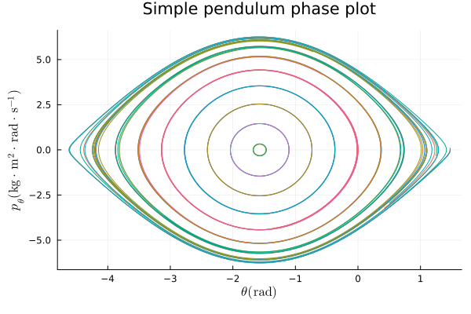

## Example: simple pendulum
The Hamiltonian for the simple pendulum is:
\begin{align}
H &= T + V \\
&= \dfrac{ml^2 \dot{\theta}^2}{2} + mgl\sin{\theta}. \label{Hsimp}
\end{align}
We can use Equation \eqref{H} to determine our Hamiltonian here because our potential energy, $V$, is independent of the generalized velocities. Problem is, however, that this is written in terms of $q_i$ and $\dot{q}_i$ not $q_i$ and $p_i$. First we need to determine what our canonical momentum is. Equations \eqref{canmom} yields:
\begin{align}
p_{\theta} &= \dfrac{\partial L}{\partial \dot{\theta}} \nonumber \\
p_{\theta} &= ml^2\dot{\theta}. \label{pthetasimp}
\end{align}
Rewriting Equation \eqref{pthetasimp} with $\dot{\theta}$ as its subject:
\begin{align}
\dot{\theta} &= \dfrac{p_{\theta}}{ml^2}. \label{thetadotsimp}
\end{align}
Substituting Equation \eqref{thetadotsimp} into Equation \eqref{Hsimp} yields:
\begin{align*}
H &= \dfrac{ml^2}{2} \left( \dfrac{p_{\theta}}{ml^2} \right)^2 + mgl\sin{\theta} \\
&= \dfrac{ml^2}{2} \dfrac{p_{\theta}^2}{m^2l^4} + mgl\sin{\theta}.
\end{align*}
Cancelling out common factors in the numerator and denominator of the kinetic energy term yields:
\begin{align}
H &= \dfrac{p_{\theta}^2}{2ml^2} + mgl\sin{\theta}. \label{Hsimpf}
\end{align}
Hence the equations of motion are:
\begin{align}
\dot{p}_{\theta} &= -\dfrac{\partial H}{\partial \theta} \nonumber \\
 &= - mgl\cos{\theta}\label{pdotthetasimp}\\
\dot{\theta} &= \dfrac{\partial H}{\partial p_{\theta}} \nonumber\\
&= \dfrac{p_{\theta}}{ml^2}.\label{thetadotsimp}
\end{align}
As we can see, Hamiltonian mechanics yields a series of first-order ordinary differential equations (ODEs) instead of second-order ODEs. Which is important because Lagrangian mechanics and Newtonian mechanics both yield second-order ODE systems. That being said, if you rewrite Equation \eqref{thetadotsimp} to make $p_{\theta}$ its subject and substitute it into Equation \eqref{pdotthetasimp} and rearrange it to make $\ddot{\theta}$ the subject, you will obtain Equation \eqref{simppen}.

Below is Julia code for solving Equations \eqref{pdotthetasimp} and \eqref{thetadotsimp} with $-\dfrac{\pi}{2} + 0.1 \leq \theta_0 \leq \dfrac{\pi}{2}-0.1$ and $-0.1 \leq p_{\theta_0} \leq 0.1$ and producing a phase plot for the solutions. For all the solutions the gravitational acceleration ($g$) was assumed to be 9.81$\mathrm{m}\cdot \mathrm{s}^{-2}$, $l$ was assumed to be $1$m and $m$ was assumed to be $1$kg. 
```julia:./code/phase_plot
using DifferentialEquations, Plots, LaTeXStrings

g, m, l = 9.81, 1.0, 1.0

function pendulum!(du, u, p, t)
    du[1] = u[2]/(m*l^2)
    du[2] = -m*g*l*cos(u[1])
end

tspan = (0.0, 10.0)
ics = [(θ₀, pθ₀) for θ₀ in range(-π/2+0.1, π/2-0.1, length=9), pθ₀ in range(-0.1, 0.1, length=3)]

plot()
for u₀ in ics
    sol = solve(ODEProblem(pendulum!, collect(u₀), tspan))
    plot!(sol, idxs=(1, 2), label=false)
end

xlabel!(L"\theta (\mathrm{rad})")
ylabel!(L"p_{\theta}(\mathrm{kg}\cdot\mathrm{m}^2\cdot\mathrm{rad}\cdot\mathrm{s}^{-1})")
title!("Simple pendulum phase plot")
savefig("Phase_plot.svg")
```
Figure \figref{phaseplot} shows the phase plot generated by the above Julia code. Each differently-coloured line represents a different value of $\theta_0$ and $p_{\theta_0}$. These elliptical lines are called "orbits" in the phase plot. $H$ is constant for a given orbit and the different orbits correspond to different $H$ values.
~~~
<figure id="phaseplot" style="float: right; width: 100%">

<figcaption>Phase plot for the simple pendulum.</figcaption>
</figure>
~~~