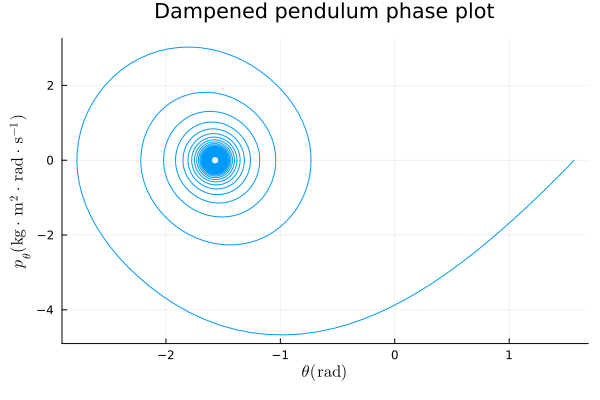

### Dampened single pendulum
In Figure \figref{phaseplot}, we see the orbits for a given set of initial conditions are closed systems. But this is for a conservative system; for non-conservative systems, where the Hamiltonian is not constant, the orbits are not closed systems and instead spiral towards the origin. Say we add Equation \eqref{Qtheta} to the right-hand side of Equation \eqref{pdotthetasimp}. This yields:
\begin{align}
\dot{p}_{\theta} &= -\dfrac{\partial H}{\partial \theta} + Q_{\theta} \nonumber \\
 &= - mgl\cos{\theta} -\dfrac{\rho C_D Al^3|\dot{\theta}|\dot{\theta}}{2} \\
 &= - mgl\cos{\theta} -\dfrac{\rho C_D Al^3\Big|\dfrac{p_{\theta}}{ml^2}\Big|\dfrac{p_{\theta}}{ml^2}}{2} \\
 &= - mgl\cos{\theta} -\dfrac{\rho C_D A|p_{\theta}|p_{\theta}}{2m^2 l}.\label{pdotthetadamp}
\end{align}

\codelisting{phaseplotdampened}{Phase plot for the dampened pendulum.}
```julia:./code/phaseplotdamp
\juliacode{fidello/code/phaseplotdamp.jl}
```
Figure \figref{phaseplotdampened} shows the phase plot generated by the above Julia code. In this phase plot, $\theta_0=\dfrac{pi}{2}-0.1$ and $p_{\theta_0}=0$. As you can see, the orbit is unstable and gradually gets closer to the origin. This is due to energy loss from the system. I am only showing one solution in the phase plot because, as the system is non-conservative, the orbits all spiral towards the origin and this would cause a lot of confusing overlap if I included multiple solutions. 
~~~
<figure id="phaseplotdampened" style="float: right; width: 100%">

<figcaption>Phase plot for the dampened pendulum.</figcaption>
</figure>
~~~