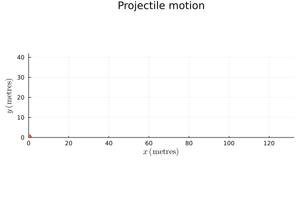

## Example: projectile motion
Let us analyse what happens when a projectile is fired into the air. Let $x$ represent the horizontal direction and $y$ represent the vertical direction.

\begin{align*}
H &= \dfrac{m}{2}(\dot{x}^2+\dot{y}^2) + mgy.
\end{align*}
As for our canonical momentum:
\begin{align*}
p_x &= m\dot{x} \hspace{0.2cm}\implies \dot{x} = \dfrac{p_x}{m}\\
p_y &= m\dot{y} \hspace{0.2cm}\implies \dot{y} = \dfrac{p_y}{m}.
\end{align*}
Hence:
\begin{align*}
H &= \dfrac{p_x^2+p_y^2}{2m} + mgy.
\end{align*}
As for air resistance it could be approximated by:
\begin{align*}
\mathbf{F}_D &= -\dfrac{\rho C_D A|v|\textbf{v}}{2} \\
&= -\dfrac{\rho C_D A\sqrt{\dot{x}^2+\dot{y}^2}}{2} (\dot{x}, \dot{y}).
\end{align*}
As for:
\begin{align*}
\dfrac{\partial \mathbf{r}}{\partial x} &= (1, 0) \\
\dfrac{\partial \mathbf{r}}{\partial y} &= (0, 1).
\end{align*}
Hence:
\begin{align*}
Q_x &= -\dfrac{\rho C_D A\sqrt{\dot{x}^2+\dot{y}^2}}{2} (\dot{x}, \dot{y}) \cdot (1,0) \\
&= -\dfrac{\rho C_D A\dot{x}\sqrt{\dot{x}^2+\dot{y}^2}}{2}\\
&= -\dfrac{\rho C_D A\dfrac{p_x}{m}\sqrt{\dfrac{p_x^2}{m^2}+\dfrac{p_y^2}{m^2}}}{2}\\
&= -\dfrac{\rho C_D A p_x\sqrt{p_x^2+p_y^2}}{2m^2}\\
Q_y &= -\dfrac{\rho C_D A\sqrt{\dot{x}^2+\dot{y}^2}}{2} (\dot{x}, \dot{y}) \cdot (0, 1)\\
&= -\dfrac{\rho C_D A\dot{y}\sqrt{\dot{x}^2+\dot{y}^2}}{2} \\
&= -\dfrac{\rho C_D A\dfrac{p_y}{m}\sqrt{\dfrac{p_x^2}{m^2}+\dfrac{p_y^2}{m^2}}}{2}\\
&= -\dfrac{\rho C_D A p_y\sqrt{p_x^2+p_y^2}}{2m^2}.
\end{align*}
Hence our equations of motion are:
\begin{align*}
\dot{x} &= \dfrac{\partial H}{\partial p_x} \\
&= \dfrac{p_x}{m} \\
\dot{y} &= \dfrac{\partial H}{\partial p_y} \\
&= \dfrac{p_y}{m} \\
\dot{p}_x &= -\dfrac{\partial H}{\partial x} + Q_x \\
&= -\dfrac{\rho C_D A p_x\sqrt{p_x^2+p_y^2}}{2m^2}\\
\dot{p}_y &= -\dfrac{\partial H}{\partial y} + Q_y \\
&= -mg -\dfrac{\rho C_D A p_y\sqrt{p_x^2+p_y^2}}{2m^2}.
\end{align*}

Below is Julia code for implementing an animation based on the above system of ordinary differential equations. 

```julia:./code/projmotion
using DifferentialEquations
using Plots
using LaTeXStrings

# Constants
g = 9.81
m = 1.0
ρ = 1.225
C_D = 0.47
A = 0.01
fps = 30

# Equations of motion
function projectile!(du, u, p, t)
    x, y, px, py = u

    v = sqrt(px^2 + py^2)

    du[1] = px / m
    du[2] = py / m
    du[3] = -(ρ * C_D * A * px * v) / (2m^2)
    du[4] = -m*g - (ρ * C_D * A * py * v) / (2m^2)
end

# Ground condition
function ground_condition(u, t, integrator)
    u[2]
end

# Terminate when the projectile crosses y = 0 while descending
function ground_affect!(integrator)
    terminate!(integrator)
end

ground_callback = ContinuousCallback(
    ground_condition,
    nothing,           # Do nothing when crossing y = 0 upwards
    ground_affect!    # Terminate when crossing y = 0 downwards
)

# Initial conditions
x₀ = 0.0
y₀ = 0.0
vx₀ = 30.0
vy₀ = 30.0

u₀ = [x₀, y₀, m*vx₀, m*vy₀]

# Integrate
tspan = (0.0, 10.0)

prob = ODEProblem(projectile!, u₀, tspan)

sol = solve(
    prob,
    callback=ground_callback,
    saveat=1/fps
)

# Animation limits
xmin = minimum(sol[1, :])
xmax = maximum(sol[1, :])
ymax = maximum(sol[2, :]) * 1.1

# Animation
anim = @animate for i in eachindex(sol.t)

    plot(
        sol[1, 1:i],
        sol[2, 1:i],
        xlabel=L"x\;(\mathrm{metres})",
        ylabel=L"y\;(\mathrm{metres})",
        title="Projectile motion",
        label=false,
        aspect_ratio=:equal,
        xlims=(xmin, xmax),
        ylims=(0, ymax)
    )

    scatter!(
        [sol[1, i]],
        [sol[2, i]],
        label=false,
        markersize=6
    )
end

gif(anim, "projectile_motion.gif", fps=fps)
```
Below is an animation of projectile motion created using the above Julia code.

~~~
<figure id="projectile_motion.gif" style="float: right; width: 100%">

<figcaption>Projectile motion animation</figcaption>
</figure>
~~~